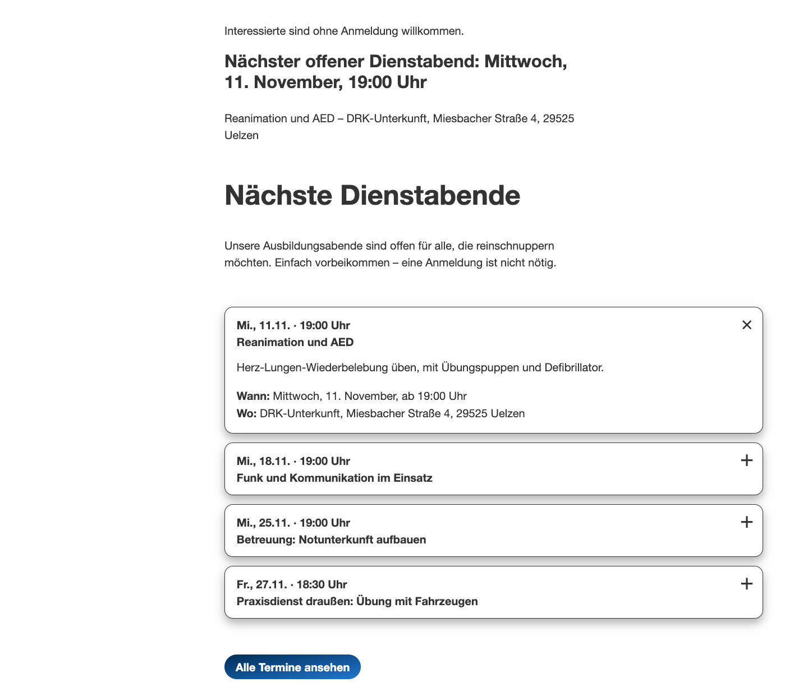
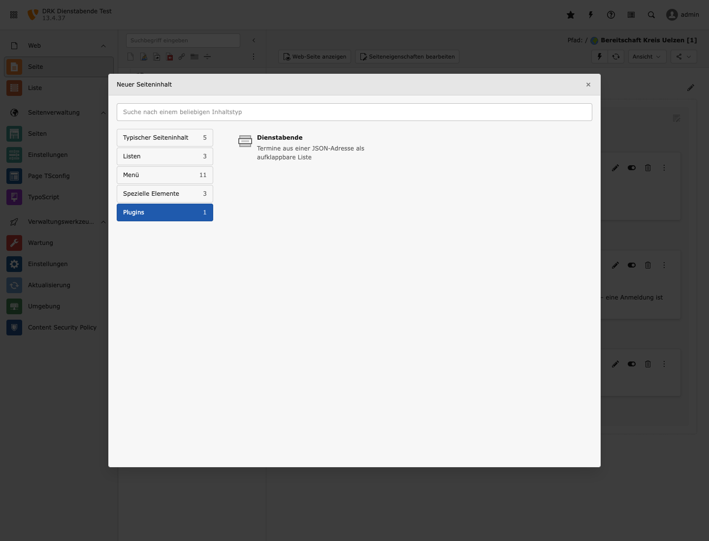
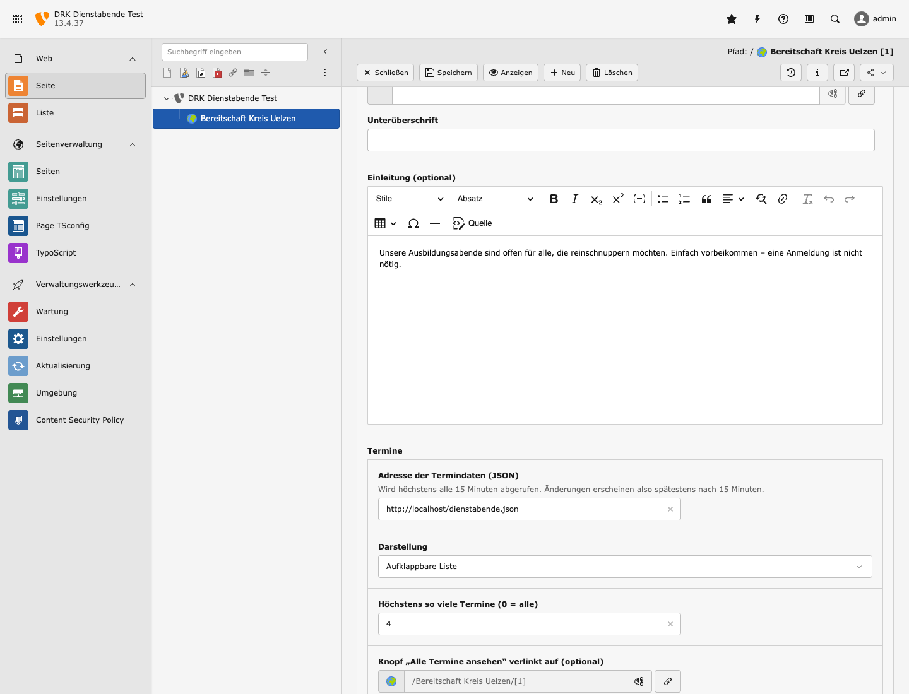
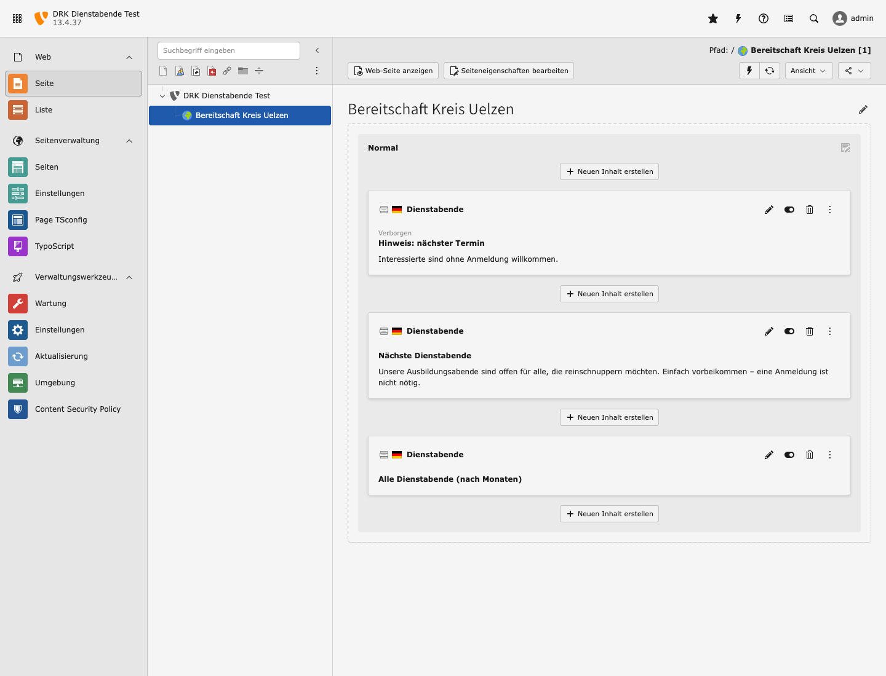

# DRK Dienstabende für TYPO3

TYPO3-Extension `drk_dienstabende` mit einem Inhaltselement **Dienstabende**. Es lädt Termine als
JSON von einer Adresse, die im Element eingetragen wird, und zeigt sie als aufklappbare Liste.
Das Markup nutzt die Klassen des DRK-CMS (`<details>`-Akkordeon), eigenes CSS gibt es nicht.

Getestet mit TYPO3 13.4.37 und 12.4.45. `testserver/` ist ein lokales TYPO3 13 in Docker zum
Ausprobieren.



## Installation

**Composer** (Standard ab TYPO3 12):

```fish
composer require rubeen/drk-dienstabende
vendor/bin/typo3 extension:setup
vendor/bin/typo3 cache:flush
```

Ist das Paket (noch) nicht auf Packagist, vorher das GitHub-Repository eintragen:

```fish
composer config repositories.drk-dienstabende vcs https://github.com/rubenvitt/typo3-drk-dienstabende
```

**Ohne Composer** (Legacy-Installation): Die ZIP-Datei `drk_dienstabende_<version>.zip` aus den
[Releases](https://github.com/rubenvitt/typo3-drk-dienstabende/releases) im Backend unter
Erweiterungen → „Erweiterung hochladen“ einspielen und aktivieren.

Es gibt keine Datenbanktabellen und kein TypoScript zum Einbinden. Die Extension hängt sich an
`lib.contentElement` an, also an das Layout, das die Seite für alle Inhaltselemente nutzt.

## Einrichtung

1. **Erlaubte Hosts eintragen** (Administration): Einstellungen → Extension-Konfiguration →
   `drk_dienstabende` → `allowedHosts`, z. B. `termine.example.org` (mehrere mit Komma).
   Ohne Eintrag ruft die Extension nichts ab und zeigt „Zurzeit sind keine Termine geplant.“
   Alternativ in `config/system/additional.php`:
   `$GLOBALS['TYPO3_CONF_VARS']['EXTENSIONS']['drk_dienstabende']['allowedHosts'] = 'termine.example.org';`
2. **Element anlegen** (Redaktion): Seitenmodul → „Neuen Inhalt erstellen“ → Reiter **Plugins** →
   **Dienstabende**.

   
3. **Ausfüllen**: Überschrift, optional eine Einleitung, dann im Abschnitt **Termine**
   - **Adresse der Termindaten (JSON)**: die URL (Pflicht, `http`/`https`, Host muss in `allowedHosts` stehen)
   - **Darstellung**: aufklappbare Liste, Liste nach Monaten (etwa für eine eigene Unterseite)
     oder nur der nächste Termin als Hinweis
   - **Höchstens so viele Termine**: 0 = alle
   - **Knopf „Alle Termine ansehen“**: optionaler Link, z. B. auf eine Unterseite

   
4. Speichern, Seite ansehen.



## JSON-Format

```json
{
  "events": [
    {
      "start": "2026-11-11T19:00:00+01:00",
      "title": "Reanimation und AED",
      "description": "Herz-Lungen-Wiederbelebung üben …",
      "location": "DRK-Unterkunft, Miesbacher Straße 4, 29525 Uelzen"
    }
  ]
}
```

| Feld | Pflicht | Bedeutung |
|---|---|---|
| `start` | ja | ISO 8601 mit Uhrzeit (`2026-11-11T19:00:00+01:00`, ohne Offset = deutsche Zeit) oder nur Datum (`2026-12-02`, dann ohne Uhrzeit angezeigt) |
| `title` | ja | Thema des Abends |
| `description` | nein | Text im aufgeklappten Termin |
| `location` | nein | Ort |

Vergangene Termine fallen weg (der laufende Tag bleibt), die Liste ist nach Beginn sortiert.
Ungültige Einträge werden übersprungen. Für ein anderes Quellformat ändert sich nur
`Classes/Domain/EventMapper.php`.

## Verhalten

- Das JSON wird höchstens alle 15 Minuten abgerufen (Timeout 3 Sekunden). „Frontend-Cache leeren“
  holt es sofort neu.
- Ist die Adresse nicht erreichbar, bleibt die letzte gültige Liste stehen. Gab es noch nie eine,
  steht dort „Zurzeit sind keine Termine geplant.“ Der Fehler landet im TYPO3-Log (`var/log/`).
  Die Seite selbst bricht nie ab.
- Das Element wird ungecacht gerendert (`COA_INT`). Ein abgesagter Termin verschwindet deshalb
  spätestens nach 15 Minuten, ohne dass jemand den Seitencache leeren muss.
- Abgerufen wird nur bei Hosts aus `allowedHosts` auf den Standard-Ports 80 und 443, Weiterleitungen werden nicht verfolgt. So kann
  die Redaktion den Server keine internen Adressen abfragen lassen. Alle Felder aus dem JSON werden
  HTML-maskiert ausgegeben.
- Auf einer Seite mit eigenem Site-Package kurz prüfen, dass Überschrift und Rahmen so erscheinen
  wie bei anderen Inhaltselementen (das Element nutzt dessen Layout `Default`).

## Testserver

Voraussetzung: Docker. Port 8080 muss frei sein.

```fish
cd testserver
docker compose up -d --build     # erster Start ca. 1–2 Minuten
docker compose logs -f typo3     # warten bis „resuming normal operations“
```

- Website: <http://localhost:8080/> (ohne DRK-Design, nur nacktes HTML)
- Backend: <http://localhost:8080/typo3/>, Benutzer `admin`, Passwort `Dienstabend#2026`
  (nur für den lokalen Test)
- Beispieldaten: `testserver/dienstabende.json`. Im Container heißt die Adresse
  `http://localhost/dienstabende.json` (ohne `:8080`, der Abruf läuft im Container).
  Änderungen an der Datei sind nach „Frontend-Cache leeren“ (Blitz-Symbol) sichtbar.
- Änderungen an der Extension wirken ohne Neubau. Bei TCA- oder Konfigurationsänderungen im
  Backend unter „Wartung“ alle Caches leeren.
- Neu aufsetzen: `docker compose down; docker compose up -d --build`
- Mapper-Prüfung: `docker compose exec typo3 php /ext/drk_dienstabende/Tests/EventMapperCheck.php`

Die Screenshots erzeugt `docs/shoot.js` (`cd docs; npm install; node shoot.js`, Testserver muss
laufen, braucht Google Chrome). `5-im-drk-design.png` setzt das HTML vom Testserver in die echte
Seite der Bereitschaft Kreis Uelzen ein.

## Lizenz

GPL-2.0-or-later, siehe [LICENSE](LICENSE).
