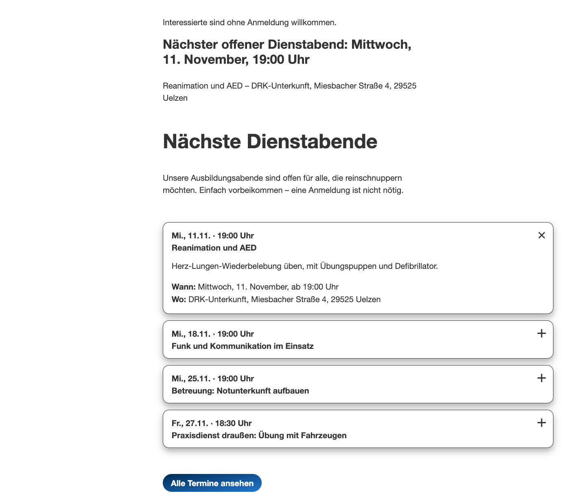
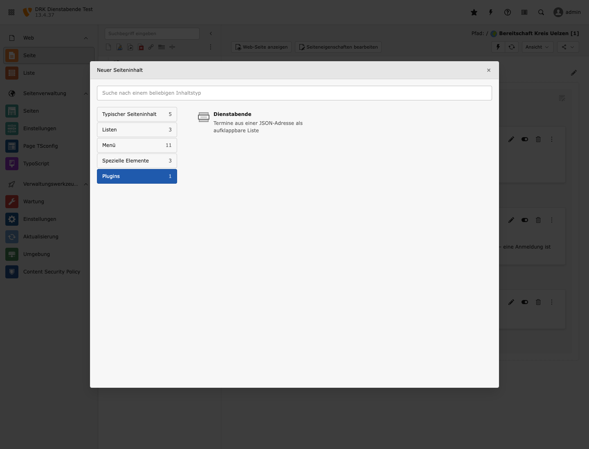
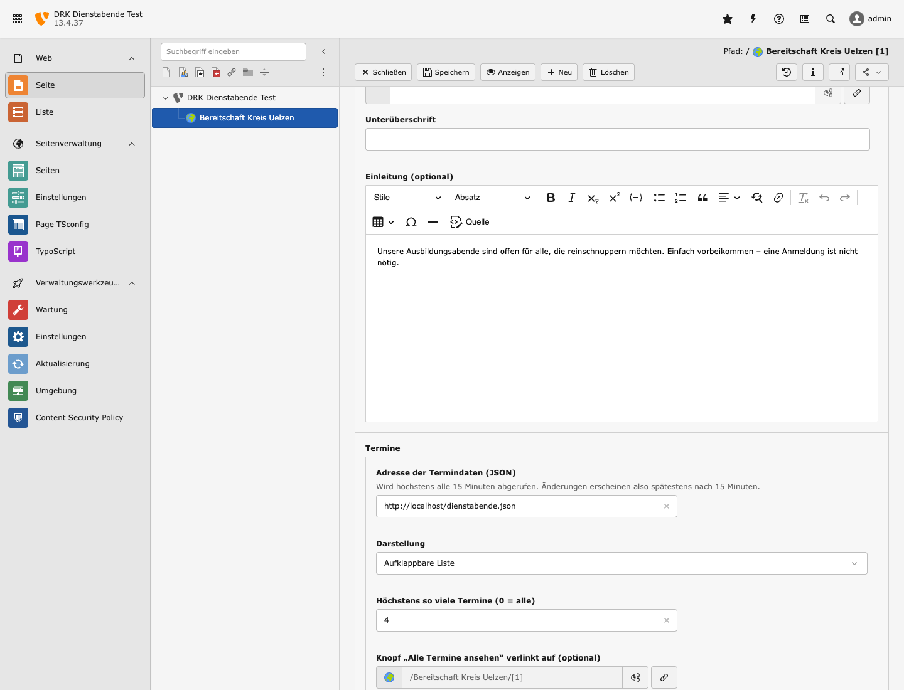

# Dienstabende-Plugin installieren und einrichten

Das Plugin fügt TYPO3 das Inhaltselement „Dienstabende“ hinzu. Im Element steht die Adresse einer
JSON-Datei mit Terminen, die Seite zeigt daraus die kommenden Dienstabende als aufklappbare Liste
im Aussehen der DRK-Seiten. Technische Details stehen im [README](../README.md).



## Bezugsquellen

- Quelltext auf GitHub: <https://github.com/rubenvitt/typo3-drk-dienstabende>
- Composer-Paket auf Packagist: <https://packagist.org/packages/rubeen/drk-dienstabende>
- ZIP-Datei für Installationen ohne Composer: unter „Releases“ im GitHub-Repository

Unterstützt werden TYPO3 12.4 und 13.4.

## Installation mit Composer

Im Projektverzeichnis der TYPO3-Installation:

```fish
composer require rubeen/drk-dienstabende
vendor/bin/typo3 extension:setup
vendor/bin/typo3 cache:flush
```

Datenbanktabellen legt das Plugin nicht an, TypoScript muss nicht eingebunden werden.

## Installation ohne Composer

1. Die Datei `drk_dienstabende_<version>.zip` aus den GitHub-Releases herunterladen.
2. Im Backend **Erweiterungen** öffnen und **Erweiterung hochladen** wählen.
3. Die ZIP-Datei hochladen und die Erweiterung aktivieren.

## Erlaubte Hosts festlegen

Das Plugin ruft Termindaten nur von freigegebenen Servern ab, über Port 80 oder 443 und ohne
Weiterleitungen zu folgen. Ohne Freigabe zeigt das Element „Zurzeit sind keine Termine geplant.“

1. Im Backend **Einstellungen** → **Extension-Konfiguration** → `drk_dienstabende` öffnen.
2. Unter `allowedHosts` den Servernamen der Termindatei eintragen, ohne `https://` und ohne Pfad,
   etwa `termine.example.org`. Mehrere Server werden durch Komma getrennt.
3. Speichern.

Alternativ in `config/system/additional.php`:

```php
$GLOBALS['TYPO3_CONF_VARS']['EXTENSIONS']['drk_dienstabende']['allowedHosts'] = 'termine.example.org';
```

## Inhaltselement anlegen

1. Im Backend links **Seite** wählen und die gewünschte Seite öffnen.
2. An der passenden Stelle **Neuen Inhalt erstellen** → Reiter **Plugins** → **Dienstabende**.

   
3. Eine Überschrift eintragen, etwa „Nächste Dienstabende“, und bei Bedarf eine kurze Einleitung.
4. Im Abschnitt **Termine** ausfüllen:
   - **Adresse der Termindaten (JSON)**: vollständige Adresse der Termindatei
   - **Darstellung**: „Aufklappbare Liste“ für die meisten Seiten, „Nach Monaten“ für eine eigene
     Terminseite, „Nur der nächste Termin“ für einen kurzen Hinweis
   - **Höchstens so viele Termine**: etwa 4; 0 zeigt alle
   - **Knopf „Alle Termine ansehen“**: optionaler Link auf eine Seite mit allen Terminen

   
5. **Speichern** und mit **Anzeigen** prüfen.

Geänderte Termine erscheinen spätestens nach 15 Minuten auf der Seite. Bleibt die Liste leer,
obwohl die Datei Termine enthält, fehlt meist der Server in `allowedHosts`. Der Grund steht dann
im TYPO3-Log unter `var/log/`.

## Neue Version veröffentlichen

1. In `ext_emconf.php` die Versionsnummer erhöhen, etwa von `0.1.3` auf `0.2.0`. Die letzte
   Stelle steht für Fehlerbehebungen, die mittlere für neue Funktionen.
2. Änderung committen, Tag mit derselben Nummer und vorangestelltem `v` setzen und pushen:

   ```fish
   cd ~/dev/personal/drk/typo3-drk-dienstabende
   git commit -am "Version 0.2.0: …"
   git tag -a v0.2.0 -m v0.2.0
   git push origin main v0.2.0
   ```

Eine GitHub Action prüft danach die Versionsnummer, führt den Selbsttest aus und legt das Release
mit ZIP-Datei an. Den Fortschritt zeigen die Reiter „Actions“ und „Releases“ im Repository.
Packagist übernimmt die neue Version automatisch.

Weicht die Nummer in `ext_emconf.php` vom Tag ab, bricht die Action ohne Release ab. In dem Fall
die Nummer korrigieren und den Tag neu setzen:

```fish
git tag -d v0.2.0; git push origin :refs/tags/v0.2.0
```

Zeigt Packagist auf der Paketseite „This package is not auto-updated“, hilft unter
<https://packagist.org/profile/> die Schaltfläche „Retry hook synchronization“.

## Zwischenversionen entfernen

Die Tags `v0.1.0` bis `v0.1.2` sind Zwischenstände ohne Release. Damit Composer sie nicht mehr
anbietet, einmalig löschen; Packagist entfernt sie danach selbst:

```fish
cd ~/dev/personal/drk/typo3-drk-dienstabende
git push origin :refs/tags/v0.1.0 :refs/tags/v0.1.1 :refs/tags/v0.1.2
git tag -d v0.1.0 v0.1.1 v0.1.2
```

## Lokal testen

Für Tests gibt es ein vollständiges TYPO3 in Docker. Es ist nur vom eigenen Rechner aus erreichbar.

```fish
cd ~/dev/personal/drk/typo3-drk-dienstabende/testserver
docker compose up -d --build
```

Nach ein bis zwei Minuten laufen die Website unter <http://localhost:8080/> und das Backend unter
<http://localhost:8080/typo3/> (Benutzer `admin`, Passwort `Dienstabend#2026`). Die Beispieltermine
liegen in `testserver/dienstabende.json`. Beenden mit `docker compose down`.

## Offene Punkte

- **Herkunft der Termine:** Das JSON-Format ist im README beschrieben. Liefert der DRKserver oder
  ein anderes System ein anderes Format, ist nur `Classes/Domain/EventMapper.php` anzupassen.
  Ebenso möglich: ein kleines Skript, das die Quelle in dieses Format umwandelt und als Datei
  auf einem Webserver ablegt.
- **TYPO3 14:** noch nicht getestet; `composer.json` erlaubt bisher nur 12.4 und 13.4.
- **TYPO3 Extension Repository (TER):** Ein Eintrag dort macht das Plugin im Extension-Manager
  auffindbar. Nötig sind ein Konto auf typo3.org und der Extension-Key `drk_dienstabende`.
